# 题库工坊 QBank

> 一个用 **WinUI 3** 写的 Windows 题库软件：把 OCS 在线题库、大模型 API、本地题库、局域网共享、图片识题放在同一个界面里，粘贴题干就能出答案，答过的题自动攒成自己的题库。

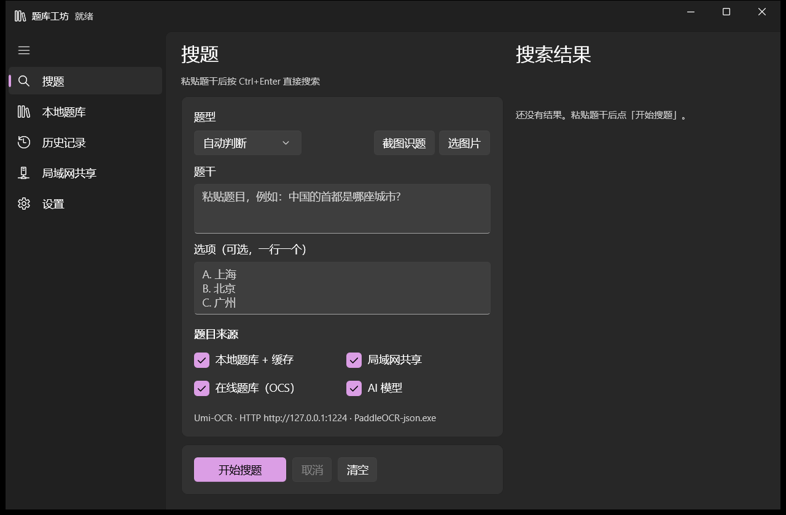

## 它是干什么的

刷网课、做在线测试的时候，最烦的是题目分散在好几个地方：OCS 脚本里挂着几个在线题库、大模型要单独开一个网页问、自己攒的题存在 Excel 里、截图里的题干还得手打。

QBank 把这些合成一个窗口：**输入题干（或者直接截图）→ 同时问本地题库 / 局域网邻居 / 在线题库 / 大模型 → 按相似度排序给出答案 → 一键存回本地**。用得越久本地题库越厚，答案来得越快，最后大部分题几十毫秒就能出结果，不再花 token。

它还能**反过来当 OCS 的题库**：开一个本机 HTTP 接口，生成标准 `AnswererWrapper` 配置，OCS 脚本收题时会来问 QBank，答案由本地题库 + 局域网 + AI 一起给。

## 主要功能

| | 功能 | 说明 |
| --- | --- | --- |
| 🔍 | **多来源并发搜题** | 本地题库、局域网、OCS 在线题库、网页搜索、AI 模型五路同时查，按相似度统一排序去重 |
| 🆓 | **网页搜索省 token** | 先拿搜索引擎里现成的答案（含作业帮/知道那类答案页），把握够高就直接用、**这次不调模型**——白嫖来的答案不花钱 |
| 📚 | **OCS 题库完全兼容** | 直接吃 OCS 的 `AnswererWrapper` 配置（JSON / 链接 / Base64），handler 用内置 JS 引擎真跑，连报错文案都和官方逐字一致 |
| 🤖 | **多模型管理** | DeepSeek、硅基流动、阿里云百炼、OpenAI、Ollama、任意 OpenAI 兼容网关；填好 Key 点「获取模型」直接从接口拉可用模型列表 |
| 🖼️ | **图片识题** | 截屏 / 选图片 → OCR → 自动填进题干和选项。四档引擎：Umi-OCR（PaddleOCR 离线，默认）、Windows OCR、Ollama 视觉模型、自定义 HTTP |
| 🗄️ | **本地题库** | SQLite 存储，模糊匹配 + 相似度精排；导入导出 JSON / CSV / TXT，答案可自动写回 |
| 🏷️ | **标签与收藏** | 自动按学科/题型打标签，也能手上一批；用「★收藏」标记重点题，按标签筛选、批量加删标签、批量删除 |
| 🌐 | **局域网共享** | 把自己变成题库服务器，UDP 自动发现同网段机器，互相查题；题库同步默认**只拉上次同步之后改动的题**（增量） |
| 🕘 | **搜索历史** | 每次搜题的来源、分数、耗时全记录，可分页翻、可一键「再搜一次」 |
| ↔️ | **反向输出给 OCS** | 把自己包装成标准 OCS 题库，让 OCS 脚本用上你的本地题库和 AI |
| 🔌 | **网络出口可切换** | 跟随系统代理 / 强制直连 / 自定义代理；系统代理指向死端口时自动绕过，**代理中途退出了也会当场改走直连重试**，不再满屏「目标计算机积极拒绝」 |
| 🪟 | **关窗口不退出** | 收进系统托盘继续跑后台服务，双击叫回窗口；托盘被环境限制时会明确告知并退回「关窗口=退出」 |
| 💾 | **设置一件打包** | 把接口、API Key、题库配置、OCR 和网络设置存成一个文件带走，换机器不用重填；可选口令加密（AES-256-GCM） |
| 🧭 | **第一次就会用** | 首次启动四步上手引导；设置项按用途分五类、按配置顺序编号；搜题页空状态直接写出「先做什么」 |

## 安装

到 [Releases](https://github.com/fotlim/QBank/releases) 下载，两种形式任选：

### 安装版 `QBank-Setup-1.0.7.exe`

双击安装，**安装路径可以随便改**（默认 `%LOCALAPPDATA%\Programs\QBank`，装到 `D:\Tools\QBank` 也行，路径带空格或中文都没问题）。

- 自带 .NET 运行时和 Windows App SDK，目标机不用另装任何东西
- 按用户安装，**不需要管理员权限**，不弹 UAC
- 可选任务：「开机自动启动」「数据跟程序放一起（便携模式）」
- 卸载时会问要不要连题库数据一起删，默认保留

### 绿色版 `QBank-1.0.7-portable.zip`

解压到任意目录，双击 `QBank.exe` 就能跑，不写注册表、不留痕迹。
想让数据跟着程序走（比如放 U 盘里），在 exe 旁边新建一个空文件 `portable.txt`。

> **安装器报「安装程序无法创建目录 …is-XXXX.tmp / 错误 5: 拒绝访问」怎么办**
>
> 这是 `%TEMP%` 被安全软件、组策略或系统加固工具限制导致的，不是安装包的问题——Inno Setup 启动时必须先在临时目录里解出真实安装程序。
> 两个办法任选：
> 1. **直接用绿色版 zip**（推荐，它不依赖临时目录）；
> 2. 或者把安装包移到别的目录再跑，或手动指定临时目录：`QBank-Setup-1.0.7.exe /TEMP=D:\temp`。


## 界面

| 首次上手引导 | 搜题页（空状态就是上手三步） |
| --- | --- |
| 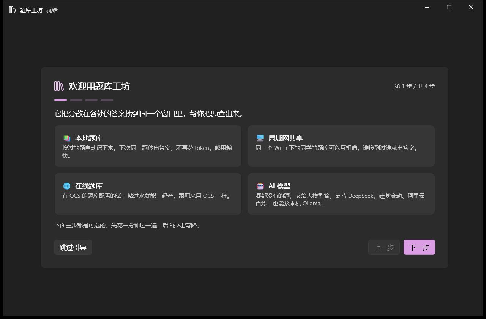 | 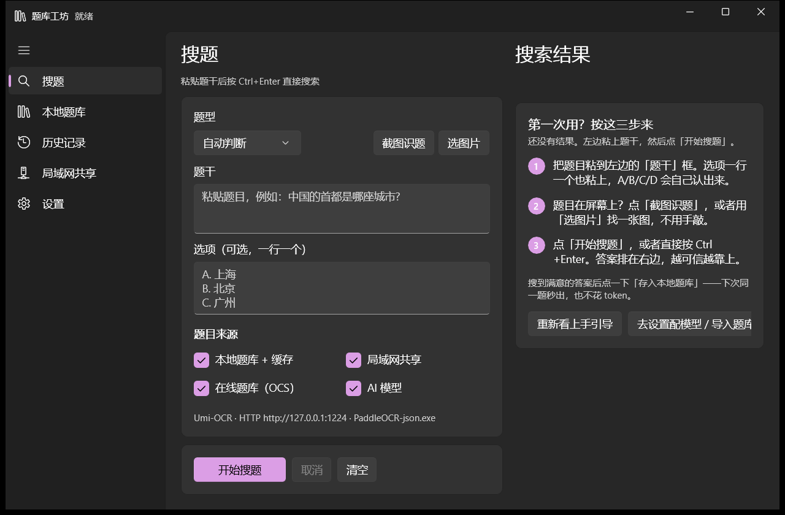 |

| 设置：左侧分类导航 | 本地题库 |
| --- | --- |
| 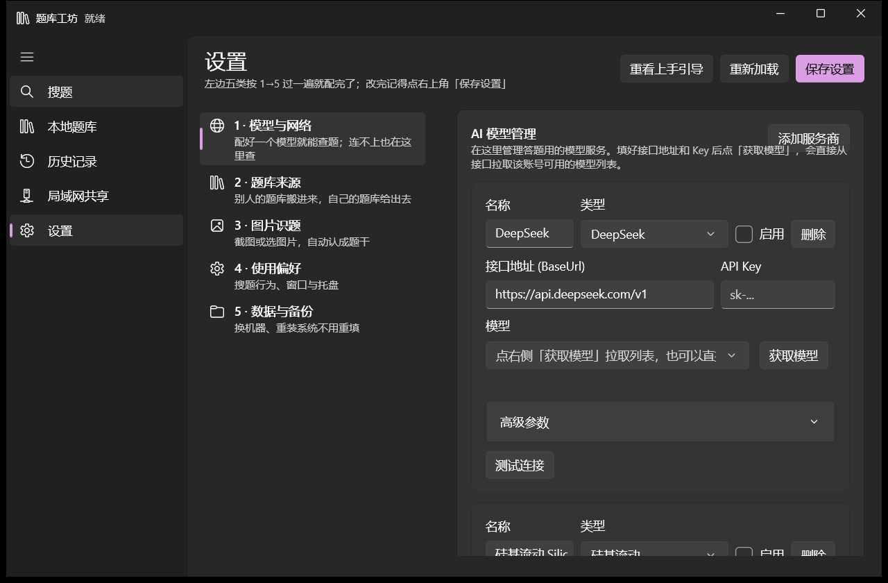 | 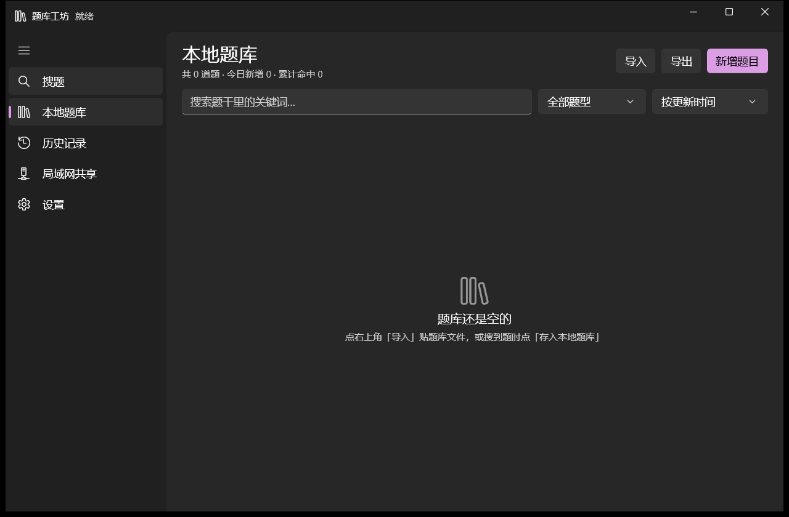 |

| 历史记录 | 局域网共享 |
| --- | --- |
| 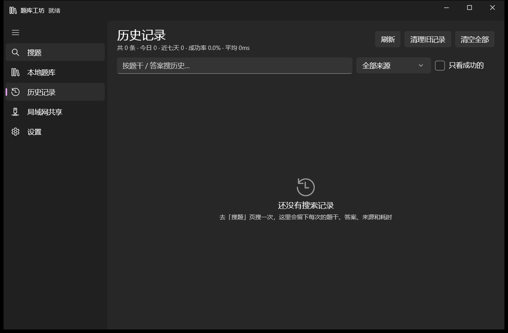 | 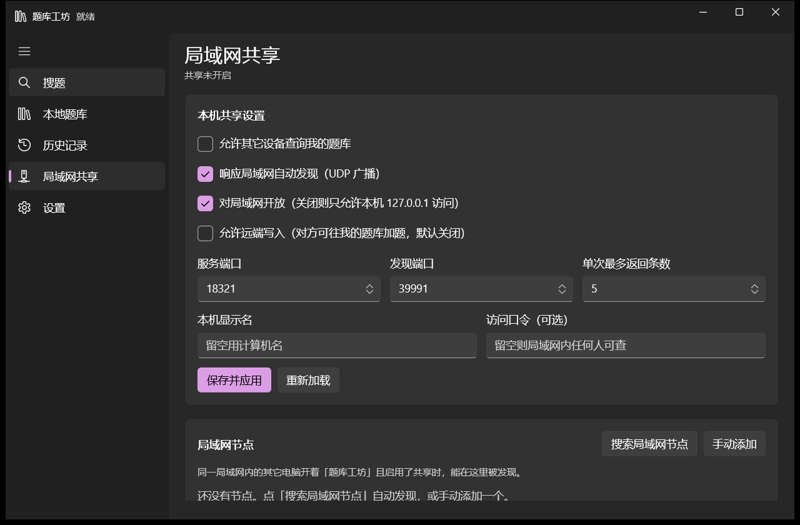 |

| OCS 对接 | 网络出口（代理） |
| --- | --- |
| 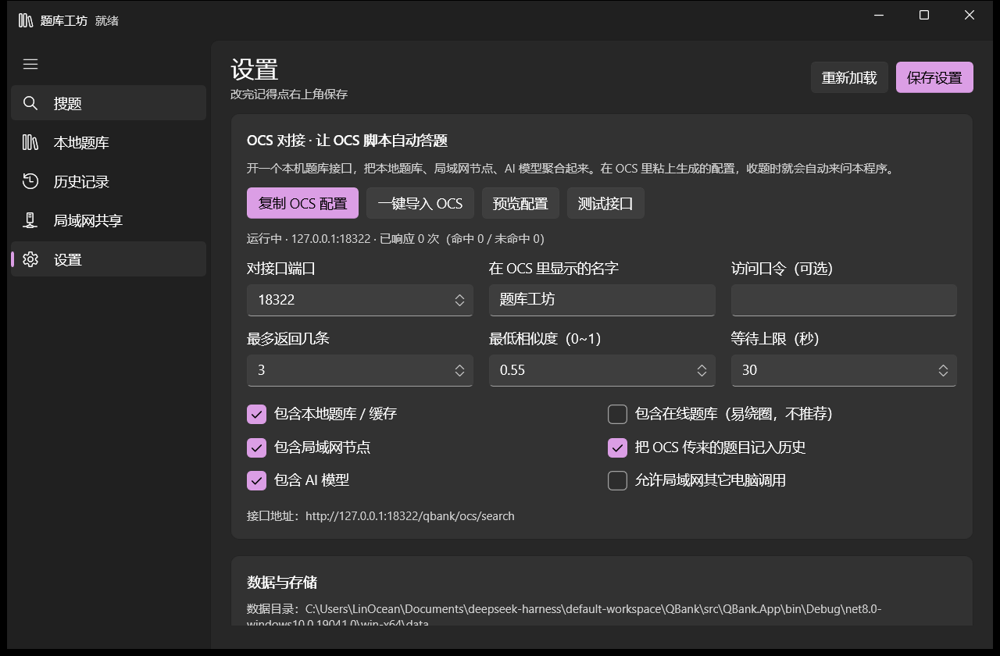 | 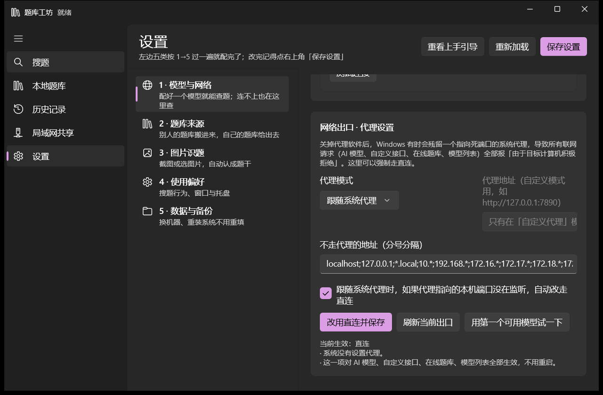 |

| 窗口与托盘 | 备份与恢复 |
| --- | --- |
| 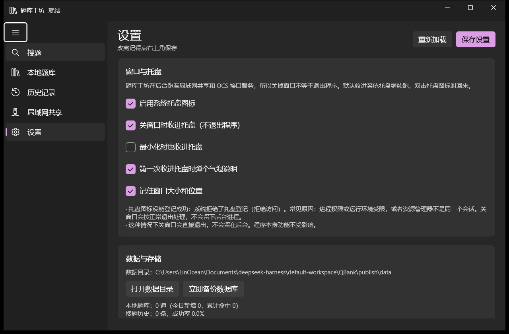 | 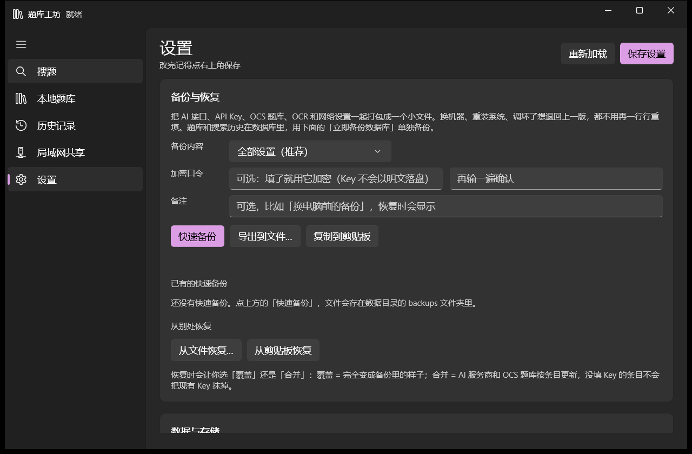 |

| 网页搜索（省 token） | 自动标签 |
| --- | --- |
| 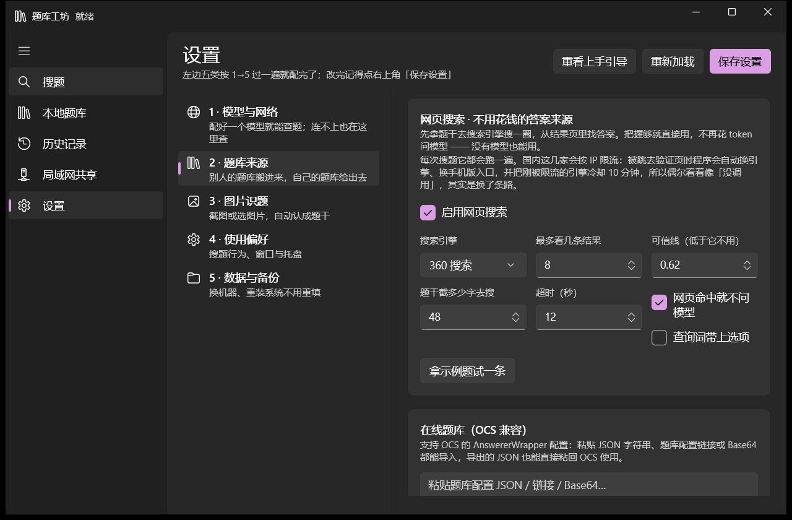 | 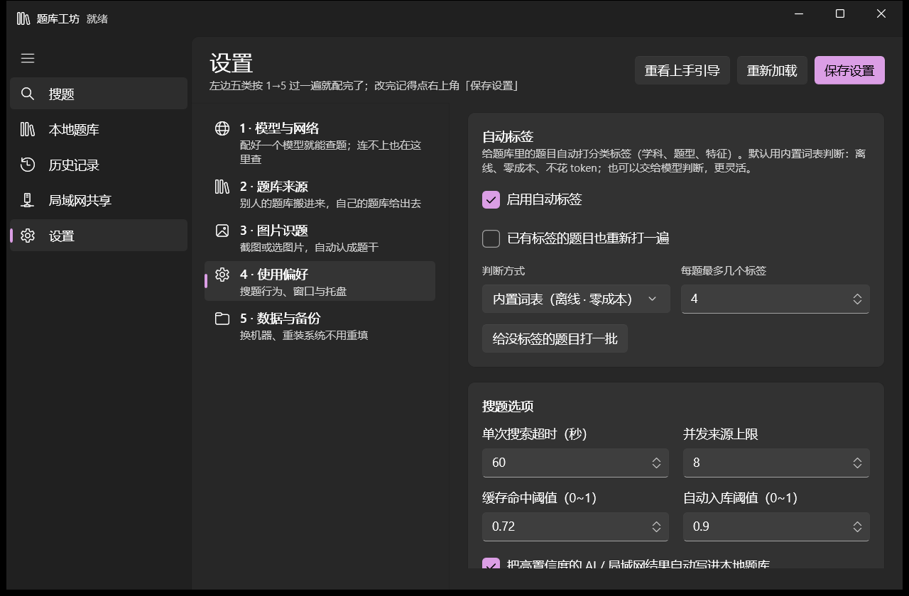 |

## 技术栈

- **界面**：WinUI 3 / Windows App SDK 2.6.4，unpackaged 直接跑 exe（免 MSIX）
- **引擎**：.NET 8，`QBank.Core` 无界面依赖，可单独引用
- **JS 执行**：Jint 4.17（纯托管，带超时 / 语句数 / 内存三重限制）
- **存储**：Microsoft.Data.Sqlite（WAL 模式）
- **HTTP**：`TcpListener` 自写极简 HTTP/1.1 服务，不用 `HttpListener`，所以免 urlacl、不需要管理员
- **自测**：`QBank.Cli` 内置 mock 服务，17 项端到端离线自测，不联网不花 token

---

## 1. 跑起来

### 环境要求

用安装包的话什么都不用装，只要求系统是 **Windows 10 1809 (17763) 及以上**。

自己从源码构建才需要：

| 项目 | 要求 |
| --- | --- |
| 系统 | Windows 10 1809 (17763) 及以上，Windows 11 更佳 |
| 构建 | .NET 8 SDK（`winget install Microsoft.DotNet.SDK.8`） |
| 图形界面 | 无需 Visual Studio，`dotnet build` 就够 |

### 构建与启动

```powershell
cd QBank
dotnet build src\QBank.App\QBank.App.csproj -c Debug
.\src\QBank.App\bin\Debug\net8.0-windows10.0.19041.0\win-x64\QBank.exe
```

发布成自带运行时的单目录（目标机无需装 .NET，**推荐**）：

```powershell
dotnet publish src\QBank.App\QBank.App.csproj -c Release -r win-x64 --self-contained true -o publish
.\publish\QBank.exe
```

> 别用 `--self-contained false`：那样产出的目录缺 `coreclr.dll`，目标机必须预装 .NET 8 桌面运行时，否则双击没反应。

发布目录里必须有 `QBank.pri`（XAML 资源索引），少了它启动会直接 `XamlParseException`。`QBank.App.csproj` 里的 `CopyPriToPublish` 目标会在 publish 后自动把它补进去，正常不用管；如果你是手工复制文件部署，记得连同 `QBank.pri` 一起拷。

### 打安装包

```powershell
# 先 publish 自带运行时版本
dotnet publish src\QBank.App\QBank.App.csproj -c Release -r win-x64 --self-contained true -o publish
# 再编译安装包（需要 Inno Setup 6）
& "C:\Program Files (x86)\Inno Setup 6\ISCC.exe" install\qbank.iss
```

产物在 `install\Output\QBank-Setup-1.0.7.exe`，232 MB 的内容压到约 63 MB。

**便携模式**：在 exe 同目录放一个 `portable.txt`（或 `portable` 文件夹），数据就存到 `exe\data`，不碰 `%LOCALAPPDATA%`。

### 数据放在哪

默认 `%LOCALAPPDATA%\QBank`，里面是 `config.json` + `qbank.db`。如果这个目录写不进去（沙箱、只读盘、权限被策略限制），程序会自动回落到 `exe\data`，再不行回落 `%TEMP%\QBank`，启动日志在 `exe\startup.log` 里写明实际用了哪个目录。

---

## 2. 界面导览

左侧五个入口：**搜题 / 本地题库 / 历史记录 / 局域网共享 / 设置**。

### 第一次打开：四步上手引导

首次启动会自动弹出一份四步引导，每步只讲一件事，可以随时「跳过引导」，也可以从**设置页右上角的「重看上手引导」**再看一遍：

1. **这是什么** —— 四个来源各自解决什么题（本地题库 / 局域网共享 / 在线题库 / AI 模型）
2. **配一个能答题的模型** —— 按钮直接跳到「设置 → 1 · 模型与网络」
3. **图片识题** —— 显示当前识别引擎，按钮跳到「设置 → 3 · 图片识题」
4. **开搜** —— 搜题三步，按钮直接回搜题页并把光标放进题干框

此外，搜题页在**没搜过题**的时候，右侧不是一句冷冰冰的「还没有结果」，而是一张「第一次用？按这三步来」的卡片，把「题干 → 来源 → 开始搜题」写清楚，底部还有「重新看上手引导」和「去设置配模型／导入题库」两个入口。

### 搜题

左边输入，右边看结果：

1. 题干框粘贴题目（或点「框选截图」「整屏识别」「选图片」自动 OCR 填入）
2. 选项框一行一个，`A. 上海` 这种带前缀的写法最省事
3. 「题目来源」勾选本次要问哪些来源（本地题库+缓存 / 局域网共享 / 在线题库 / **网页搜索（省 token）** / AI 模型）
4. 「开始搜题」或 **Ctrl+Enter**

题目在屏幕上时更方便：**Ctrl+V 直接粘贴截图**（Win+Shift+S 截的也行）、**把图片文件拖进窗口**、或者「框选截图」在全屏上拉一个框——三种都会自动 OCR 并识别出题干和选项。

结果区顶部是「最佳答案」大卡片（一键复制 / 存入本地题库），下面按分数列出所有来源的候选，卡片上标着来源名和相似度。

### 本地题库

搜索（题干、答案、标签都能搜）、按题型筛选、**按标签筛选**（下拉里第一项就是「★ 收藏」）、按更新时间/命中数/标题排序；每页 50/100/200 条可翻页。

批量操作：勾选多道题（或「全选本页」）后可以一次性 **加标签 / 去掉标签 / 设为收藏 / 取消收藏 / 自动打标签 / 删除**。单条能编辑（改题干、选项、答案、标签后保存）。

还支持导入（JSON / CSV / TXT，可直接从剪贴板粘贴）、导出（写文件 + 复制到剪贴板）、手动新增。

### 历史记录

每次搜题的完整记录：题干、答案、来源、分数、耗时、成功与否。可以「再搜一次」跳回搜题页并自动重搜，也能按关键词/来源筛选、只留成功的、清理旧记录；条数多了可以翻页（每页 50/100/200）。

### 局域网共享

见第 10 节。

### 设置

设置项按用途分成**左边五类**，按「第一次该怎么配」的顺序编号，从上往下点一遍就配完了（右上有「重新加载 / 保存设置」，改完记得保存）：

| 分类 | 管什么 | 里面的卡片 |
| --- | --- | --- |
| **1 · 模型与网络** | 配好一个模型就能查题；连不上也在这里查 | AI 模型管理、网络出口 |
| **2 · 题库来源** | 别人的题库搬进来，自己的题库给出去；网页上现成的答案也在这 | 网页搜索、在线题库（OCS 兼容）、OCS 对接 |
| **3 · 图片识题** | 截图或选图片，自动认成题干 | 图片识题（OCR） |
| **4 · 使用偏好** | 搜题行为、自动标签、窗口与托盘 | 搜题选项、自动标签、窗口与托盘 |
| **5 · 数据与备份** | 换机器、重装系统不用重填 | 备份与恢复、数据与存储 |

每张卡片的作用：

- **AI 模型管理**：卡片式管理多个模型服务，填好 BaseUrl 和 Key 后点「获取模型」直接从接口拉可用模型列表
- **网络出口**：代理模式（跟随系统 / 直连 / 自定义），解决"关了代理软件就全报网络错误"的坑（见第 4 节）
- **网页搜索**：选搜索引擎、可信线、每次看几条，以及「命中网页答案就跳过 AI」（见第 5 节）
- **在线题库（OCS）**：粘贴 JSON / 链接 / Base64 导入，导出的 JSON 能直接粘回 OCS（见第 8 节）
- **OCS 对接**：开本机题库接口，让 OCS 脚本能直接来问（见第 11 节）
- **图片识题**：选引擎、配参数、一键自检（见第 9 节）
- **搜题选项**：超时、并发、缓存命中阈值、自动入库阈值
- **自动标签**：给没标签的题目批量打标签——词表（离线、免费）、本地模型或某个在线模型
- **窗口与托盘**：关窗口收进托盘继续后台跑（见第 6 节）
- **备份与恢复**：把接口和 Key 打成一个文件带走，可加口令加密（见第 7 节）
- **数据与存储**：数据目录、打开目录、备份数据库、题库统计

---

## 3. 配一个大模型

设置页 →「添加服务商」，六个预设任选：

| 预设 | 接口地址 | 默认模型 |
| --- | --- | --- |
| DeepSeek | `https://api.deepseek.com/v1` | `deepseek-chat` |
| 硅基流动 | `https://api.siliconflow.cn/v1` | `deepseek-ai/DeepSeek-V3` |
| 阿里云百炼 | `https://dashscope.aliyuncs.com/compatible-mode/v1` | `qwen-plus` |
| OpenAI | `https://api.openai.com/v1` | `gpt-4o-mini` |
| Ollama（本地） | `http://127.0.0.1:11434/v1` | `qwen3:8b` |
| 自定义 | 自己填 | 自己填 |

任何 OpenAI 兼容网关都能用（OneAPI、LiteLLM、vLLM、LM Studio……），选「自定义」填 BaseUrl 即可。

### 模型管理

- 点「**获取模型**」：真的去接口拉该账号可用的模型列表（`GET {base}/models`；Ollama 走原生 `/api/tags`，能顺带拿到参数量和量化等级）
- 模型下拉框可以编辑，手填也行
- 拉到视觉模型（`*-vl`、`llava`、`gpt-4o` 之类）时会提示勾选「支持图片输入」
- **高级参数**里可以改温度、最大 tokens、超时、优先级，也能塞额外请求体参数（比如 `{"enable_thinking": false}`）和自定义提示词

程序内置的答题提示词要求模型只输出 JSON（`answer` / `question` / `confidence` / `explain`），并且按题型规范化答案：单选填一个字母，多选连写 `ABD`，判断题映射成选项字母，填空多空用 `#` 分隔。

---

## 4. 网络出口（代理）

这一节值得单独看 —— 它是最容易被忽略、又最能把人卡住的一项。

### 症状

搜题时返回类似：

```
AI 模型：网络请求失败：由于目标计算机积极拒绝，无法连接。 (127.0.0.1:12000)
```

或者「获取模型」拉不到列表、自定义接口也连不上。**这不是 Key 的问题，也不是网络的问题**，是系统代理把自己坑了。

### 原因

Windows 的「Internet 选项 → 局域网设置」里存着一个代理地址。开着 Clash / Fiddler 时它指向 `127.0.0.1:7890` 之类；关掉软件后，**这个注册表值不会被清掉**：

```
HKCU\Software\Microsoft\Windows\CurrentVersion\Internet Settings
    ProxyEnable = 1
    ProxyServer = 127.0.0.1:12000    ← 软件已经关了，这个端口没人监听
```

于是每一个走系统代理的 HTTP 请求都被送去一个空端口，立刻被拒绝。浏览器有时能用是因为它的白名单里正好有这个域名 —— 你可以在 `ProxyOverride` 里看到 `www.siliconflow.cn` 却没有 `api.siliconflow.cn`，于是网页能开、程序不能连。

### 怎么办

设置页 →「网络出口」卡片，三选一：

| 模式 | 什么时候用 |
| --- | --- |
| **跟随系统代理**（默认） | 你开着代理软件，希望程序也跟着走 |
| **直连（忽略系统代理）** | 关代理后全报错，或者你根本不走代理 —— 选这个最省事 |
| **自定义代理** | 想指定一个跟系统不一样的代理，比如 `http://127.0.0.1:7890` |

改完点「保存设置」，**立刻生效，不用重启**（HTTP 客户端会重建）。

### 自动兜底

默认勾着「跟随系统代理时，如果代理指向的本机端口没在监听，自动改走直连」。两层兜底：

**① 建客户端时探一次**（200ms 超时，不拖慢启动）

- 端口没人监听 → 直接绕过它，写明 `系统代理 http://127.0.0.1:12000 没有响应，已自动改走直连。`
- 判定同时看两处：`.NET` 自己的 `HttpClient.DefaultProxy` 解析结果，以及注册表原文 —— 有些进程环境下前者读不到系统代理，只看一条会漏。

**② 请求失败时再救一次**（这一层治的是「开着开着代理没了」）

代理软件是先开着的，程序启动时它活着，于是客户端就带着它跑。你后来把代理关掉 —— 那个已经缓存的代理对象还在，之后每条请求都「积极拒绝」。

- 只要报错是「积极拒绝」+「本机端口」（`127.0.0.1:` / `localhost:` / `[::1]:`），程序认定代理坏了：**记下来 + 立刻改用直连重试一次**
- 重试成功时答案里会带一句「系统代理没在跑，这次已自动改走直连。」，不是悄悄糊弄过去
- 之后**所有**请求（AI、模型列表、自定义接口、在线题库、局域网）一律直连，不会再卡第二次
- 状态行会写明「已确认系统代理不可用，现在一律直连」；哪天你重新开代理软件，回设置里**再点一次保存**就恢复跟随系统代理

嫌麻烦就直接点卡片上的 **「改用直连并保存」** —— 一键把模式写成直连、保存、重建客户端，专治关了代理软件以后全都不通。

### 这一项管到哪些请求

AI 模型、模型列表拉取、自定义接口、OCS 在线题库、局域网节点、Ollama 视觉识题 —— **全部**。改一处，全通。

### 还是不通？

1. 点卡片上的「用第一个可用模型试一下」，它会真的打一次接口并把结果写在下面
2. 如果报 401/403 那是 Key 的事，跟代理无关
3. 如果是自建 HTTPS 服务报证书错，在服务商「高级参数」里允许不安全证书

---

## 5. 网页搜索（不花钱的答案来源）

搜题时先去搜索引擎翻一遍：作业帮、百度知道这类页面经常把题目和答案一起写在正文里，本程序把结果页抓下来，用几套本地启发式（「正确答案是 B」这种句式、选项在正文里出现的次数、题干吻合度）推一个答案，**够可信就直接用它，这一步不调模型、不花 token**。

设置页 →「2 · 题库来源」→「网页搜索」：

| 项 | 说明 |
| --- | --- |
| 启用 | 总开关；关掉就只有本地题库 / 局域网 / OCS / AI 四路 |
| 搜索引擎 | **360 搜索（默认）**、搜狗、必应、百度，或者「自定义」（填自己的 URL 模板，用 `{q}` 当查询词占位） |
| 每次看几条结果 | 默认 8 |
| 可信线 | 默认 0.62；低于它的网页答案只会在结果里显示成「网页里似乎有答案但把握不够」，不会被当答案用 |
| 查询词长度 | 题干太长时只截前 N 个字去搜（默认 48） |
| 把选项也写进查询词 | 开着更容易命中答案页，代价是查询串更长 |
| 命中网页答案就跳过 AI | 默认开——这就是「省 token」的关键：网页给出可信答案时，这次请求根本不发给模型 |

搜题页左侧「题目来源」里的 **网页搜索（省 token）** 勾选框是这一次搜题的开关。

### 引擎可用性（重要）

各家搜索站都会按 IP 限流，被限流时会把请求 302 跳到一个验证页（360 是 `qcaptcha.so.com`，搜狗是 `antispider`），这时本程序会：

1. 认出这是验证页，**自动换下一个引擎再试**（默认顺序：你选的 → 360 → 搜狗 → 必应）；
2. .NET 直连谈不下 TLS 的站点（360 就是，它不接受 TLS 1.3）**自动改用系统自带的 `curl.exe`** 再抓一次；
3. 全都抓不到时，结果页只会多一行说明（比如「被跳去验证页了（这个搜索站暂时在限流，过一会儿再试或换个引擎）」），**不影响其它来源**——本地题库、局域网、OCS、AI 照常出结果。

所以：急着要答案时别忘了把 AI 那一路也留着，网页搜索是加分项，不是替代品。测试时别猛刷，越刷越容易被要验证码。

「拿示例题试一条」按钮会用一道示例题真搜一次，把命中结果、把握和理由摊开给你看，方便判断当前引擎在你这条线路上好不好使。

## 6. 窗口与托盘

题库工坊后台跑着**局域网共享**和 **OCS 接口服务** —— 关掉窗口就把这些服务一起掐了，别人的 OCS 脚本会突然查不到题。所以默认行为是**关窗口 = 收进系统托盘**，程序继续在后台跑。

设置页 →「窗口与托盘」：

| 选项 | 默认 | 作用 |
| --- | --- | --- |
| 启用系统托盘图标 | 开 | 关掉就退回「关窗口 = 退出」的老行为 |
| 关窗口时收进托盘 | 开 | 打勾时点 × 只隐藏窗口；不打勾时点 × 直接退出程序 |
| 最小化时也收进托盘 | 关 | 打勾后点最小化也不占任务栏 |
| 第一次收进托盘时弹个气泡 | 开 | 只弹一次，说明程序还在后台 |
| 记住窗口大小和位置 | 开 | 下次启动还原上次的尺寸和位置 |

**托盘图标怎么用**

- **双击** → 把窗口叫回来
- **右键** → 菜单三项：打开主界面 / 打开数据目录 / 退出题库工坊

**想彻底退出**，请走托盘右键菜单的「退出题库工坊」——它会正常保存配置、关掉共享服务、摘掉托盘图标。直接任务管理器结束进程虽然也能关，但配置改动会丢。

> **托盘图标没出现？**
>
> 极少数环境（远程桌面、被系统策略限制的会话、某些安全软件）会让 Shell_NotifyIcon 返回"拒绝访问"，图标登记不上。这时程序会**自动退回「关窗口 = 退出」**，不会留下没有窗口也没有图标的后台进程。设置页那张卡片底部会直接写出失败原因，程序其余功能不受影响。

---
## 7. 备份与恢复设置

换机器、重装系统、调崩了想退回上一版 —— 不用再一行行重填 API Key。设置页 →「备份与恢复」，把 **AI 接口 / API Key / OCS 题库 / OCR 和网络设置**打成一个 `.qbankcfg` 小文件（十几 KB），拷走就能带走全部配置。

> 注意范围：这里只备份**设置**。题目和搜索历史在 `qbank.db` 里，用下面「数据与存储」的「立即备份数据库」单独备。

### 三种存法

| 按钮 | 存到哪 | 什么时候用 |
| --- | --- | --- |
| 快速备份 | 数据目录的 `backups\` 文件夹，文件名带时间戳 | 平时随手存一个，出事了在旁边列表点「恢复」 |
| 导出到文件… | 自己选位置（U 盘、网盘、GitHub 私库都行） | 换机器、重装前留底 |
| 复制到剪贴板 | 剪贴板里的 JSON 文本 | 想临时贴到别处或发给自己的另一个设备 |

「备份内容」选 **全部设置** 或 **仅 AI 模型**（只要接口和 Key、不带别的）。

### 加密口令

口令是可选的。填了就用 **AES-256-GCM + PBKDF2-SHA256（12 万次迭代）** 加密，文件里不会出现明文 Key —— 把备份扔进网盘也不用担心。

- 不填口令就是明文 JSON，**里面有你所有 API Key**，程序会弹窗再提醒一次
- 忘了口令**没法恢复**，程序不存口令，也没有后门
- 加密后仍然能读到元信息（几个服务商、多大、什么时候导的），方便你挑文件

### 恢复

从文件、从剪贴板，或直接在「已有的快速备份」列表里点「恢复」。恢复前会让你选：

| 模式 | 效果 |
| --- | --- |
| **覆盖** | 完全变成备份里的样子，本机当前的设置全被替换 |
| **合并** | 按条目逐项更新：备份里没填 Key 的服务商**不会**把你现有的 Key 抹掉 |

两条规矩：

1. **数据目录永远保留本机值** —— 备份里的 `DataDir` 不会被恢复，否则换机器后程序会到处找不到数据库
2. **窗口位置会被清空** —— 上一台机器的坐标放到你这台屏幕上可能已经在屏幕外了

快速备份列表每行显示范围、大小、时间、备注、是否加密、有没有 Key，带「恢复」「删除」两个按钮。备份文件格式是带 `format: "qbank-settings"` 标记的 JSON，恢复时会校验，随便哪个 JSON 扔进来会提示「这不是题库工坊的设置备份」。

---
## 8. 导入 OCS 在线题库

完全兼容 [OCS 的 AnswererWrapper 规范](https://docs.ocsjs.com/docs/other/api#AnswererWrapper)。设置页 →「在线题库」→ 粘贴下面任一形式 → 导入：

- JSON 数组字符串
- 题库配置的 http(s) 链接
- Base64 编码的配置

```json
[
  {
    "name": "示例题库",
    "url": "https://example.com/api/search?title=${title}&type=${type}",
    "method": "get",
    "contentType": "json",
    "handler": "return (res) => res.data.map(item => [item.question, item.answer])"
  }
]
```

字段与 OCS 一致：`url`（必填）、`name`（必填）、`homepage`、`data`、`method`（get/post）、`contentType`（json/text）、`type`（fetch/GM_xmlhttpRequest）、`headers`、`handler`（必填）。

`handler` 用内置的纯托管 JS 引擎（Jint）执行，等价于 OCS 的 `Function(handler)()`，并且提供 `localStorage` 和 `console` 垫片——OCS 文档里「用 localStorage 存上下文再改传给 AI」那套写法可以原样搬过来。脚本有超时、语句数、内存三重限制，恶意配置拖不死程序。

校验错误信息与 OCS 官方源码逐字一致（`第 N 个题库的 名字(name) 为空` 等），方便直接对照排查。

### 与 OCS 的两处有意差异

1. **URL 占位符只编码替换值本身**。OCS 会把整个 URL 再 `encodeURIComponent` 一遍，这里不做，避免双重编码把中文题干变成乱码。
2. **未识别的占位符替换成空串**。OCS 会替换成字面量字符串 `"undefined"`。

另外 POST 请求时，如果 header 里的 `Content-Type` 是 `application/x-www-form-urlencoded`，本程序会发标准表单体（比 OCS 的 fetch 分支只会 `JSON.stringify` 更实用）。

---

## 9. 图片识题

搜题页有两个按钮：「截图识题」（截整个屏幕）和「选图片」（从文件选）。识别完自动填进题干和选项框。

四档引擎，在设置页切换：

| 引擎 | 说明 | 需要什么 |
| --- | --- | --- |
| **Umi-OCR**（默认） | PaddleOCR 离线引擎，中文识别效果好，全程本机 | 装 [Umi-OCR](https://github.com/hiroi-sora/Umi-OCR)，设置页点「探测安装位置」 |
| Windows OCR | 系统自带 `Windows.Media.Ocr`，零下载、最省事 | 系统装了中文语言包 |
| Ollama 视觉模型 | 本地大模型读图（如 `qwen2.5vl:7b`） | 本机跑着 Ollama |
| 自定义 HTTP | 任意 OCR 服务，POST 图片 base64 | 自己填 URL 和结果路径 |

Umi-OCR 优先走它的 HTTP 接口（默认 `127.0.0.1:1224`，注意 Umi-OCR 里可以改成别的端口），连不上就自动退回直接调 `PaddleOCR-json.exe` 单图模式，两条路都不需要联网。

识别出的文本会按「题号 + 题干 + A/B/C 选项」的结构切分（设置里可关掉自动切分）。

---

## 10. 局域网题库共享

### 当服务端（把题库借给别人查）

局域网页 →「本机共享设置」：

- 勾「允许其它设备查询我的题库」
- 勾「响应局域网自动发现」→ 别人能自动搜到你
- 勾「对局域网开放」→ 不勾就只允许本机 127.0.0.1 访问（调试用）
- 可选填「访问口令」
- 「保存并应用」

用的是自写的 TcpListener 极简 HTTP 服务，**不需要管理员权限、不需要 urlacl、不用改防火墙规则**（首次监听时 Windows 可能弹一次防火墙授权，允许即可）。

路由：`GET /qbank/ping`、`POST /qbank/query`、`POST /qbank/add`、`GET /qbank/export`，口令走 `x-qbank-token` 头或 `token` 查询参数。

### 当客户端（查别人的题库）

- 点「**搜索局域网节点**」→ UDP 广播自动发现同网段正在共享的机器
- 或者「手动添加」，填 IP 和端口
- 每个节点都能单独测试连通性、移除

搜题时勾上「局域网共享」即可，会并发问所有已添加的节点。

「题库同步」里还能把自己的题推给所有节点（对方要允许远程写入），或者从所有节点把题库拉过来。

---

## 11. 给 OCS 提供题库（让 OCS 脚本自动答题）

这一节是整个程序最有意思的部分：把 QBank 变成一个**OCS 能直接调用的题库接口**，于是 OCS 脚本收题时就会来问本程序，答案可以由本地题库、局域网邻居、甚至大模型给出。

### 怎么用（三步）

1. 打开 设置 →「**OCS 对接 · 让 OCS 脚本自动答题**」，确认状态是「运行中 · 127.0.0.1:18322」。
2. 点「**复制 OCS 配置**」。
3. 到 OCS 的「题库配置」里粘贴，或者用「一键导入 OCS」让它直接把配置链接交给 OCS。

生成的配置长这样（数值随你的设置变化）：

```json
[{
  "name": "题库工坊",
  "url": "http://127.0.0.1:18322/qbank/ocs/search?title=${title}&options=${options}&type=${type}&token=你的口令",
  "method": "get",
  "contentType": "json",
  "type": "fetch",
  "headers": {},
  "handler": "return (res) => { ... }"
}]
```

这就是**标准 OCS AnswererWrapper**，字段与 OCS 官方完全一致——因为本程序内部就是按 OCS 的解析器实现了一遍（连报错文案都逐字对齐），所以它在 OCS 里和普通题库没有区别。

### 接口返回什么

严格按 OCS 约定：

| 情况 | 返回 |
| --- | --- |
| 命中 | `[[null, "B"], [null, "C"]]`（题目为 null，OCS 用当前搜索的题干） |
| 未命中 | `["题库工坊未命中", null]`（会显示成 OCS 的一条通知） |
| 口令错 | `["访问口令不正确", null]` |

`handler` 就是把这几种形态翻译成 OCS 认识的 `[[题目, 答案], ...]`；未命中时转成 `[消息, undefined]`。**这个 handler 不是手写的，是程序按 OCS 规范生成后，再丢进真正的 JS 引擎里跑过一遍验证的**（自测里的「OCS 对接口」那项）。

### 接口清单

| 路由 | 用途 |
| --- | --- |
| `GET /qbank/ocs/ping` | 健康检查 |
| `GET /qbank/ocs/search?title=…&options=…&type=…` | 搜题（也接受 POST JSON / 表单） |
| `GET /qbank/ocs/ocs.json` | **纯配置数组**，可直接当「题库配置链接」导入 OCS |
| `GET /qbank/ocs/config` | 带元信息的包装版 |
| `GET /qbank/ocs/docs` | 接口说明 |
| `GET /qbank/ocs/export` | 导出本地题库 |

CORS 已放开（含 Chrome 私有网络访问需要的 `Access-Control-Allow-Private-Network`），所以网页版 OCS 从 https 页面访问 127.0.0.1 也能通。

### 回答由谁给

卡片上的勾选决定这次搜索会问哪些来源，默认是「本地题库 + 局域网 + AI」：

- **包含本地题库 / 缓存** —— 命中最快，通常几十毫秒
- **包含局域网节点** —— 问同网段其它开着 QBank 的机器
- **包含 AI 模型** —— 前两者都没答案时才值得开，注意会花 token
- **包含在线题库** —— 默认关。开了会绕圈：OCS 问你 → 你问 OCS 里配的题库 → 那个题库可能就是你自己

「最低相似度」控制松紧（默认 0.55，太高容易找不到，太低容易答错）；「最多返回几条」对应 OCS 的多题库候选。

### 常见问题

**OCS 里显示「未命中」但我确实有这道题？** 把「最低相似度」调低到 0.4 试试；或者确认那道题真的在本地题库里（搜题页搜一下）。

**换个程序也要能用吗？** 可以，接口就是普通 HTTP，返回标准 JSON。不会写 handler 就直接用 `[[null,"答案"]]` 这种结构。

**安全吗？** 默认只绑 `127.0.0.1`，只有本机能访问。要跨机器用得勾「允许局域网其它电脑调用」，并建议设一个访问口令。

---

## 12. 命令行自测

`src\QBank.Cli` 是一套离线端到端自测，内置 mock 的 OCS 题库 / OpenAI 兼容接口 / 局域网服务，**不联网、不花 token**：

```powershell
dotnet run --project src\QBank.Cli\QBank.Cli.csproj -c Debug                # 常规 22 项
dotnet run --project src\QBank.Cli\QBank.Cli.csproj -c Debug -- --ocr       # 加上本机 Umi-OCR 实机识别（23 项）
dotnet run --project src\QBank.Cli\QBank.Cli.csproj -c Debug -- --verbose   # 打印每项断言
dotnet run --project src\QBank.Cli\QBank.Cli.csproj -c Debug -- --only 局域网 # 只跑名字含「局域网」的
```

覆盖：相似度打分、题型推断、答案切分（含代码题保护）、OCS 配置校验（错误文案逐字比对）、JS handler 执行与 localStorage、OCS GET/POST 请求、AI 答题（含 json 模式被 400 拒绝后的自动重试）、模型列表拉取（OpenAI 风格 + Ollama 原生）、**网络出口（死代理绕行、端口探活、代理对象构建）**、**AI 死代理自动直连（复刻「代理软件关了以后请求全报拒绝」：带死代理的客户端第一条失败 → 自动改走直连重试成功 → 记住并后续一律直连 → 重新保存设置后恢复）**、**设置备份与恢复（覆盖/合并、口令加密往返、不抹 Key、快速备份文件读写）**、本地题库增删查、**题库标签与分页（★收藏整词匹配、TagStats、无标签筛选、增量导出信封）**、导入导出、历史记录、**自动标签（词表打标签、并发批量、跳过已有、覆盖模式）**、**网页答案解析（离线仿 360 结果页：切片、取真实地址、选项解析、判出 B、判断题、无关页不给高把握）**、局域网服务端与客户端（含口令校验）、**OCS 对接口（起真 HTTP 服务 + 把生成的 handler 丢进 JS 引擎跑一遍）**、OCR 题干切分、搜题总编排（多来源并发 + 缓存短路）。

还有一个**联网探针**，用来现场排查搜索站好不好使（会真的上网，别猛刷）：

```powershell
# 直接搜一条，打印标记统计、解析结果、判定与理由；退出码 0=可信 2=没答案 3=没抓到
dotnet run --project src\QBank.Cli -- --web "中国的首都是哪座城市？" --options "A.上海`nB.北京`nC.广州`nD.深圳" --engine so360
dotnet run --project src\QBank.Cli -- --web "..." --dump tools\raw.html    # 把原始 HTML 落盘
dotnet run --project src\QBank.Cli -- --web "..." --html tools\raw.html   # 离线解析本地 HTML（反复调参用）
dotnet run --project src\QBank.Cli -- --tag "求函数 f(x)=x²+1 的最小值" --options "A.0`nB.1"  # 只看词表会打什么标签
```

退出码 0 = 全过。

---

## 13. 项目结构

```
QBank/
├─ src/
│  ├─ QBank.Core/          # 引擎（无界面依赖，net8.0-windows10.0.19041.0）
│  │  ├─ Models/           # Question、QuestionType、SearchModels、AppConfig
│  │  ├─ Ocs/              # AnswererWrapper 解析、JS handler 执行、题库请求、答案切分
│  │  ├─ Ai/               # OpenAI 兼容客户端、答题服务、模型目录
│  │  ├─ Search/           # 相似度打分、搜题总编排、网页搜索与答案推断
│  │  ├─ Storage/          # SQLite 本地题库（含标签/收藏/增量）、搜索历史、配置读写、设置备份
│  │  ├─ Lan/              # 局域网 HTTP 服务端、UDP 发现、客户端（含增量同步）
│  │  ├─ Http/             # 极简 HTTP/1.1 服务（TcpListener，免 urlacl）
│  │  ├─ Bridge/           # OCS 对接口：把搜题结果包装成 OCS 题库
│  │  └─ Ocr/              # Umi-OCR / Windows OCR / Ollama / 自定义、截屏、框选、题干切分
│  ├─ QBank.Cli/           # 离线自测 + 联网探针（--web / --tag）
│  └─ QBank.App/           # WinUI 3 界面
│     ├─ Pages/            # 搜题、本地题库、历史、局域网、设置
│     ├─ Controls/         # 服务商编辑卡、四步上手引导、框选截图层
│     └─ Services/         # 应用级单例、配置保存、托盘图标
└─ tools/
   ├─ smoke-shot.ps1       # 起窗口 → 截图 → 关掉（无头烟测）
   └─ scroll-shot.ps1      # 同上，可滚动 / 翻页后再截
```

---

## 14. 常见问题

**点搜题没反应 / 没结果**
先看结果区的来源卡片，每个来源都会写失败原因。最常见是没配 API Key（401）、BaseUrl 少了 `/v1`（404）、或者一个来源都没勾。

**接口返回「不是合法 JSON」**
题库返回的其实是 HTML 错误页或纯文本。把该题目的 `contentType` 改成 `text`，再让 `handler` 按字符串处理。

**「获取模型」失败**
401/403 是 Key 不对；404 检查 BaseUrl 是否要以 `/v1` 结尾；429 是限流或额度不足。Ollama 显示连不上就确认 `ollama serve` 在跑。

**截图识题抓到的图不对**
「整屏识别」抓的是整个虚拟桌面（多屏会全抓进来）。只要某一块就用「框选截图」在屏幕上拉一个框，或者干脆 **Ctrl+V 粘贴**（配 Win+Shift+S 截得更准），也能「选图片」。

**网页搜索没出答案，说「被跳去验证页了」**
搜索站在按 IP 限流，过一会儿再试、或在设置页换一个引擎。这不影响其它来源——本地题库、局域网、OCS、AI 照常出结果（见第 5 节）。

**中文在命令行输出乱码**
`QBank.Cli` 已强制 UTF-8 输出；如果还是乱，先 `chcp 65001`。

**数据目录到底在哪**
看 `exe\startup.log` 最后几行，会写「应用已启动，数据目录：…」。

**OCS 里点了「提交」但没反应**
先确认设置页那张卡片写着「运行中」；再点「测试接口」，能弹「接口正常」说明服务没问题。还是不行就检查 OCS 里那条题库的 URL 端口和本程序一致（被占用时端口会自动 +1，以界面显示的为准）。

**在 OCS 里改了口令但本程序没改**
两边必须一致。本程序改完口令要「保存设置」才会重建服务，OCS 那边也要重新导入配置。

**报「由于目标计算机积极拒绝，无法连接 (127.0.0.1:xxxxx)」**
系统代理残留。关掉代理软件后 Windows 不会清掉 `ProxyServer` 注册表值，请求全被送去一个死端口。（1.0.7 起程序会**当场自动改走直连并重试**，答案里会注明「系统代理没在跑，这次已自动改走直连」；想彻底不再跟代理纠缠，就到设置 →「网络出口」点**「改用直连并保存」**，详见第 4 节。）

**自定义接口 / 自建网关也连不上**
跟上面同一个原因 —— 网络出口是全局的，对自定义接口一样生效。改成直连就行。

**点 × 之后窗口没了，程序还在跑吗**
在跑，这是默认行为（收进了托盘）。双击任务栏右下角的鱼图标叫回来。真想退出就走托盘右键菜单的「退出题库工坊」。如果不喜欢这个行为，设置 →「窗口与托盘」把「关窗口时收进托盘」的勾去掉。

---

## 15. 已知限制

- 目前只支持 Windows（WinUI 3 + Windows.Media.Ocr + 系统截屏都是 Windows 专属）。
- 网页搜索依赖公开搜索页，**各家都会按 IP 限流**：被限流时会 302 到验证页，程序会认出并换引擎重试，全都不行时只是少一个来源，不影响其它四路（见第 5 节）。
- 网页答案靠本地启发式推断（答案句式、选项出现频次、题干吻合度），把握不够时宁可不给，不保证每题都能白嫖到。
- OCS 的 `GM_xmlhttpRequest` 类型按 fetch 处理（功能等价，只是不经过浏览器的油猴 API）。
- 局域网服务是明文 HTTP，口令也是明文传输，只适合可信内网。
- OCS 对接口同时只处理有限并发（默认 8 条），OCS 一次提交几十道题时会排队，不会丢题但会慢。
- 托盘功能靠 `Shell_NotifyIcon` 实现，少数受限环境（远程桌面、被策略限制的会话）会登记失败。这时程序会自动退回「关窗口=退出」并在设置页写明原因，不会留下看不见的隐藏进程。
